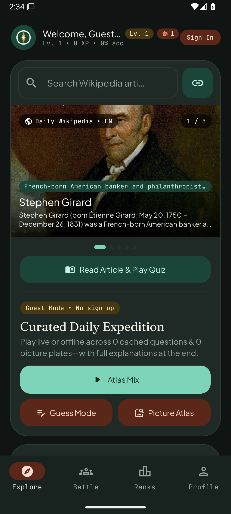
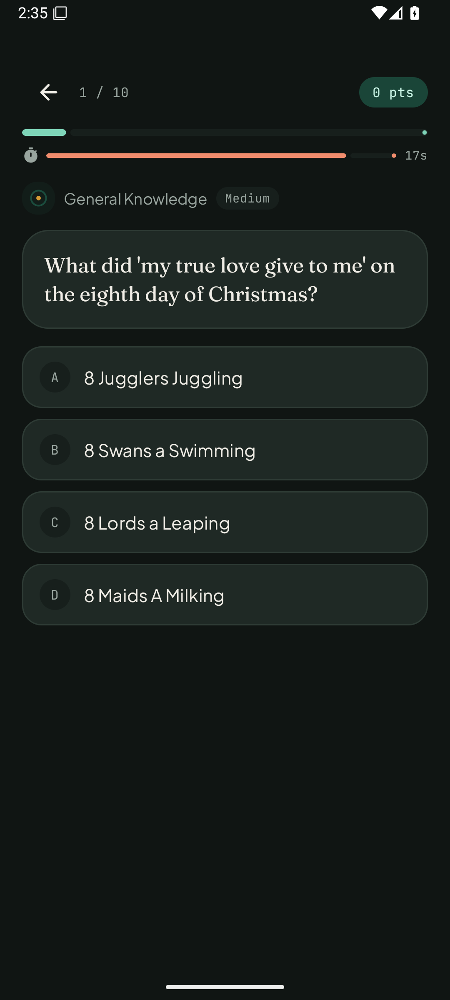
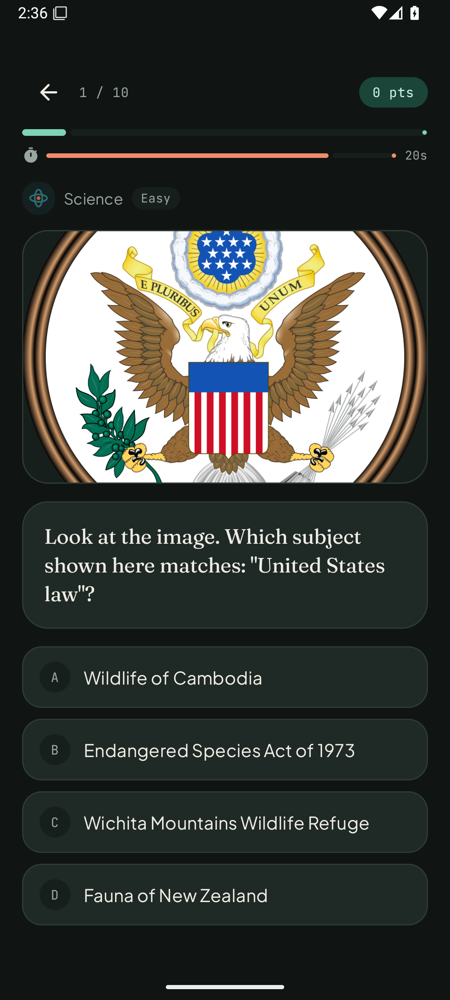
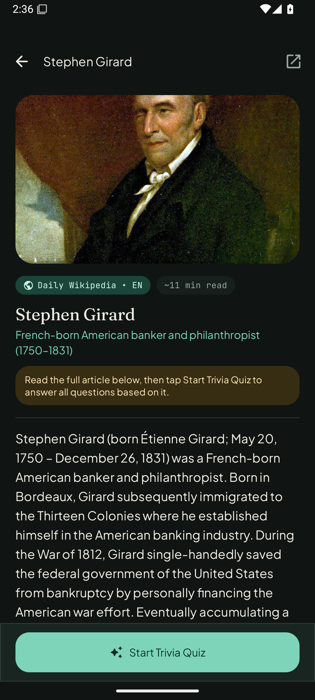

# Trivia Atlas


-3DDC84?style=flat-square&logo=android&logoColor=white)


**Trivia Atlas** is a modern Android trivia, encyclopedic discovery, and real-time multiplayer battle application built by **[brillian11](https://github.com/brillian11)** with **Kotlin**, **Jetpack Compose (Material Design 3)**, **Room**, **DataStore**, **Wikipedia APIs**, **Bring-Your-Own-Key (BYOK) Gemini AI**, and **Firebase**.

---

## Screenshots

| Explore & Daily Wikipedia | Live Quiz Mode |
| :---: | :---: |
|  |  |

| Picture Atlas Visual Rounds | Wikipedia Article Reader & Quiz |
| :---: | :---: |
|  |  |

---

## Key Features

### Gameplay & Knowledge Discovery
- **Three Playable Modes**:
  - **Multiple Choice Quiz** — Classic timed or relaxed rounds with speed-bonus scoring.
  - **Guess Mode (1.5x XP)** — Type free-form answers with fuzzy matching, optional hints, and 1.5x bonus XP.
  - **Picture Atlas** — Visual identification questions powered by live illustrated Wikimedia/Wikipedia plates.
- **11+ Curated Categories**: Atlas Mix, General Knowledge, Science, History, Geography, Arts & Literature, Film & TV, Music, Sport & Leisure, Food & Drink, Technology, and Society & Culture.
- **Daily Wikipedia Carousel, Search & Custom URL Reader**:
  - Browse 5 personalized daily Wikipedia articles directly on the Explore feed.
  - Search any Wikipedia article or paste **any custom web/Wikipedia URL** to read it distraction-free and immediately generate a trivia quiz from its contents.
- **Post-Round Answer Explanations**: Every question includes rich encyclopedic explanations sourced from article text or Wikipedia summaries—working across both named-entity and conceptual questions.

### On-Device Personal Gemini AI (BYOK) + Automatic Instant Fallback
- **Strict On-Device Key Vault**: Users can optionally paste their own Google Gemini API key (`AIzaSy...`) in **Profile -> Custom Gemini API Key**. Keys are hidden in the UI, stored strictly on-device via `DataStore`, and never leave the device or sync to Firestore.
- **Dynamic Model Discovery**: Queries Google's `models` endpoint using the user's own API key to populate compatible models in a dropdown menu without hardcoding stale model lists.
- **Zero-Failure Fallback**: When reading Wikipedia or Custom URLs (solo or in Friend Battles), the app automatically tries your configured Gemini model first and seamlessly falls back to the deterministic on-device **Instant Article Quiz** engine if offline or if the AI request fails.

### Friend Battle Mode (Real-Time Multiplayer)
- **Shared Synchronized Rooms**: Host 6-character Battle Rooms (up to 12 players) via Room Code or direct friend invitations.
- **Multiple Question Sources**: Pick multiple trivia **Topics**, **Search Wikipedia**, or paste a **Custom URL** so every player answers the exact same generated article deck.
- **Timed Rules & Live Standings**: 30s per question, signed XP scoring (`+XP` right, `-XP` wrong, `0 XP` pass/timeout), real-time Firestore participant scoreboard, and shared post-battle review.

### Progression, Daily Objectives & Global Ranks
- **30-Scenario Per-User Daily Objectives**: 3 randomized daily challenges tailored per explorer (e.g., *"Get 10/10 in Geography"*, *"Ace a Daily Wikipedia Quiz"*, *"Solve 5+ Geography Guess answers with 0 hints"*). Tapping an objective launches the matching mode directly.
- **Daily Streak & Streak Freezes (Max 3)**: Automatic check-in streaks protected by Streak Freezes earned via:
  1. Earning **10,000+ XP** in a single day
  2. Completing all **3 Daily Objectives** for **3 consecutive days**
  3. Reaching a new **Explorer Level**
- **Lifetime Level & Weekly Resetting Leaderboard**: Weekly XP ranking cycles reset every **Sunday 12:00 PM GMT** (with an H-1 countdown window), while Lifetime Explorer Levels never reset.

### Offline-First & Multilingual Polish
- **Offline Room Database Cache**: Download, play, and refresh questions locally; offline rounds queue automatically and sync when reconnected.
- **Guest Mode + Seamless Google Sign-In**: Play immediately without sign-up, or sign in via **Jetpack Credential Manager** to sync cloud profiles, rankings, and multiplayer battles.
- **Trilingual Support**: Instant in-app switching across **English (`en`)**, **Español (`es`)**, and **Bahasa Indonesia (`in`)**, plus **Auto / Daylight / Night** Material 3 themes.

---

## APIs, Data Sources & Key Requirements

| Service / API | Endpoint / SDK | Purpose in Trivia Atlas | API Key / Credential Required |
| :--- | :--- | :--- | :--- |
| **The Trivia API** | `https://the-trivia-api.com/v2/questions` | Primary live multi-category trivia feed | None (public endpoint) |
| **Open Trivia Database (OpenTDB)** | `https://opentdb.com/api.php` | Secondary live trivia source fallback | None (public endpoint) |
| **Wikipedia MediaWiki API** | `https://{lang}.wikipedia.org/w/api.php` | Daily carousel, article search, full text reader, Picture Atlas plates, and answer explanations | None (public endpoint + custom `User-Agent`) |
| **Google Translate GTX** | `https://translate.googleapis.com/translate_a/single` | Live EN → ES/ID quiz translation & cross-language explanations | None (public endpoint) |
| **Google Gemini API (BYOK)** | `https://generativelanguage.googleapis.com/v1beta/` | Optional AI quiz generation & model discovery from Wikipedia / Custom URLs | **Optional User BYOK (`AIzaSy...`)** — entered in-app on Profile, stored strictly on-device |
| **Firebase Auth, Firestore & App Check** | `com.google.firebase:firebase-*` + `CredentialManager` | Google Sign-In, user profiles, weekly leaderboard, real-time battle rooms, security rules | `app/google-services.json` + OAuth Web Client ID + SHA-1/SHA-256 fingerprints |

---

## Tech Stack & Open-Source Repositories

- **UI & Design**: [Jetpack Compose](https://developer.android.com/compose), [Material Design 3](https://m3.material.io/), Material Icons Extended, Adaptive `BoxWithConstraints` / Window Insets (`enableEdgeToEdge`)
- **Architecture & Concurrency**: MVVM, Repository pattern, Kotlin Coroutines & `StateFlow`, Type-safe Navigation Compose
- **Local Persistence**: [Room](https://developer.android.com/training/data-storage/room) (`TriviaDatabase` + KSP), [Jetpack DataStore Preferences](https://developer.android.com/topic/libraries/architecture/datastore) (`ThemePreferences`, `LocalGeminiKeyVault`)
- **Networking & Serialization**: [Square Retrofit](https://github.com/square/retrofit), [Square OkHttp](https://github.com/square/okhttp), [Square Moshi](https://github.com/square/moshi) (with KSP codegen)
- **Media Loading**: [Coil Compose](https://github.com/coil-kt/coil) (`createAtlasImageLoader`)
- **Authentication & Cloud Backend**: [Firebase Android SDK](https://github.com/firebase/firebase-android-sdk) (`firebase-auth`, `firebase-firestore`, `firebase-appcheck`), [Jetpack Credential Manager](https://developer.android.com/identity/sign-in/credential-manager) + `googleid`
- **Testing**: JUnit 4, Kotlinx Coroutines Test, [Robolectric](https://github.com/robolectric/robolectric), Compose UI Test (`androidx.compose.ui:ui-test-junit4`), Firebase Firestore Emulator rules suite (`firestore.test.js`)

---

## Project Structure

```text
trivia-atlas/
├── app/
│   ├── build.gradle.kts              # Android app config, dependencies, Secrets plugin
│   ├── google-services.json          # Firebase Android config (supply your own project config)
│   └── src/
│       ├── main/
│       │   ├── AndroidManifest.xml
│       │   ├── java/com/example/
│       │   │   ├── MainActivity.kt               # Edge-to-edge host, NavHost, DI wiring
│       │   │   ├── data/
│       │   │   │   ├── firebase/                 # BattleRepository, UserProgressRepository, AppCheck
│       │   │   │   ├── local/                    # Room DB, DAOs, DataStore, Seed banks, KeyVault
│       │   │   │   ├── model/                    # Domain models, ProgressionSystem, DailyObjectives
│       │   │   │   ├── remote/                   # TriviaApiService, WikipediaApiService, OnlineTriviaSources
│       │   │   │   └── repository/               # TriviaRepository, WikipediaRepository
│       │   │   └── ui/
│       │   │       ├── auth/                     # Google Sign-In & Credential Manager helpers
│       │   │       ├── components/               # Shared Compose badges & avatars
│       │   │       ├── screens/                  # Explore, Quiz, ArticleReader, Battle, Ranks, Profile
│       │   │       ├── theme/                    # Material 3 Theme, Typography, AtlasColors
│       │   │       └── viewmodel/                # Screen ViewModels & StateFlows
│       │   └── res/
│       │       ├── values/                       # English strings & styles
│       │       ├── values-es/                    # Spanish localization
│       │       └── values-in/                    # Indonesian localization
│       └── test/                                 # Unit & Robolectric test suite
├── docs/
│   └── screenshots/                  # App showcase screenshots
├── firestore.rules                   # Zero-trust Cloud Firestore security rules
├── firestore.test.js                 # Node emulator security rules tests
├── firebase-blueprint.json           # Firestore entity & collection schema blueprint
├── gradle/libs.versions.toml         # Centralized Gradle version catalog
├── .env.example                      # Environment placeholder template
├── LICENSE                           # MIT License
└── README.md
```

---

## Setup & Running Locally

### 1. Prerequisites
- **Android Studio** (Meerkat / Ladybug or newer) with **JDK 11+** & Android SDK 36
- **Gradle** (`gradle` / Android Studio sync)
- A **Firebase Project** (if running Google Sign-In, Cloud Firestore Leaderboard, and Battle Mode)

### 2. Firebase & Google Sign-In Configuration
1. Create a Firebase project in the [Firebase Console](https://console.firebase.google.com/).
2. Register an Android app using `applicationId = "com.aistudio.triviaatlas.qzvkmx"` (or update `defaultConfig.applicationId` in `app/build.gradle.kts` to your own ID).
3. Add your debug and release **SHA-1 / SHA-256** fingerprints in Firebase Project Settings (required for Google Sign-In via Credential Manager).
4. Enable **Google** under **Authentication -> Sign-in method** and provision **Cloud Firestore**.
5. Download `google-services.json` and place it in `app/google-services.json`.
6. Deploy the zero-trust Firestore security rules:
   ```bash
   firebase deploy --only firestore:rules
   ```

### 3. Gemini AI API Key (Optional — Bring Your Own Key)
No Gemini API key is required to build or run **Trivia Atlas**. All trivia, Wikipedia reading, Instant Article Quizzes, and Battle Mode work out of the box.
- To enable AI-crafted quizzes inside Wikipedia Reader or Custom URL Battles, open **Profile -> Custom Gemini API Key** inside the app and paste a key from [Google AI Studio](https://aistudio.google.com/apikey).
- The key stays strictly on-device and dynamically loads your compatible Gemini models.

### 4. Build & Test
```bash
# Build debug APK
gradle :app:assembleDebug

# Run JVM & Robolectric unit tests
gradle :app:testDebugUnitTest
```

### 5. CI/CD & Automated APK Releases (GitHub Actions)
This repository includes two automated workflows in `.github/workflows/`:
- **Android CI (`android-ci.yml`)**: Automatically runs `:app:testDebugUnitTest` and builds the debug `.apk` on every push or pull request to `main`.
- **Build & Release APK (`release.yml`)**:
  - Automatically runs tests, builds installable `.apk` files, extracts release notes from [`CHANGELOG.md`](CHANGELOG.md) + recent git commits, computes `SHA256SUMS.txt`, and publishes them with attached `.apk` files on the **GitHub Releases** page.
  - Pushing commits to `main` updates the **`latest`** build release with the newest `.apk`.
  - Pushing a version tag (e.g. `git tag v1.0.0 && git push origin v1.0.0`) or triggering **Run workflow** in the Actions tab publishes an official versioned release.
  - *(Optional Release Signing)* Add repository secrets `RELEASE_KEYSTORE_BASE64` (using `keyAlias = "upload"`), `STORE_PASSWORD`, and `KEY_PASSWORD` in GitHub **Settings -> Secrets and variables -> Actions** to also attach a release-signed `.apk` alongside the debug `.apk`.

---

## Developer

Developed by **brillian11**  
GitHub: [https://github.com/brillian11/trivia-atlas](https://github.com/brillian11/trivia-atlas)

Licensed under the [MIT License](LICENSE).
